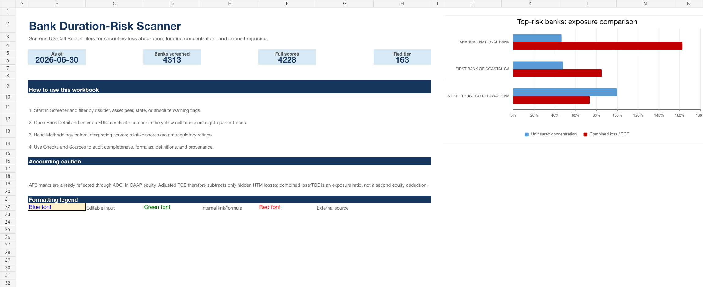
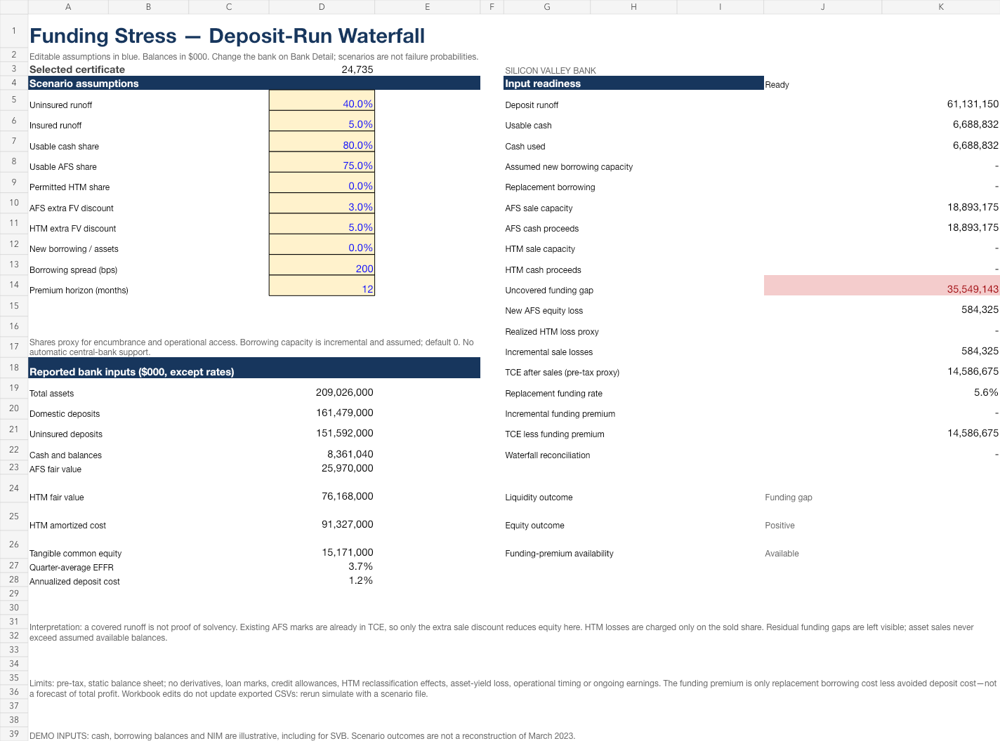

# Bank Duration-Risk Scanner

I built this project to better understand the balance-sheet risks behind bank failures like Silicon Valley Bank. I also wanted to practice using Python, SQL and Excel with real bank data.

The scanner looks at US banks and asks three main questions:

- How large are their unrealized securities losses compared with tangible common equity?
- How much do they rely on uninsured deposits?
- Are their deposit costs rising faster, or falling more slowly, than market rates?

It also includes a simple stress test for what could happen if depositors withdrew part of their money.

This is a learning project, not a tool for predicting bank failures or making investment recommendations.



## Quick start

You need Python 3.11 or newer. Replace `your-username` with the GitHub account hosting this repository.

```bash
git clone https://github.com/your-username/bank-duration-risk-scanner.git
cd bank-duration-risk-scanner
python -m venv .venv
source .venv/bin/activate              # Windows: .venv\Scripts\activate
python -m pip install -e ".[dev]"
bank-risk scan --as-of latest --quarters 8
```

The main command downloads public data and creates the reports. You do not need API credentials for it.

To try the project without downloading data, run:

```bash
bank-risk demo
```

The demo uses a separate database, `data/demo_bank_risk.sqlite`. Most of its history and liquidity inputs are made-up examples. A few SVB figures are used to check the calculations, as explained below. The demo does not show how the model would have performed in the past.

## Everyday commands

```bash
# Download bank data and create the reports.
bank-risk scan --as-of latest --quarters 8

# Create reports again using data already saved on your computer.
bank-risk export --as-of 2026-06-30

# Run a stress test for one bank using saved data.
bank-risk simulate --as-of 2026-06-30 --cert 3511 --scenario config/stress_scenario.yml
```

Use a date and bank certificate number that are in your database. The certificate number is the bank's FDIC identifier. Leave out `--cert` to run the stress test for all banks. The `export` command creates both CSV and Excel files.

## What the project creates

```text
data/bank_risk.sqlite
outputs/<quarter>/
  bank_duration_risk_detailed.csv
  bank_duration_risk_top50.csv
  bank_duration_risk_stress.csv
  bank_duration_risk_scanner.xlsx
  run_manifest.json
  scenarios/                         # Saved stress-test results and assumptions
```

The detailed CSV contains the full bank screen. The top-50 file lists banks first by capital warning, then by score completeness and score. It is a starting point for closer research, not a list of banks expected to fail.

The report shows eight quarters by default. The scanner also downloads five earlier quarters so it can calculate changes in deposit costs. It saves downloads for reuse and updates existing database records instead of adding duplicates. `run_manifest.json` records the settings and data fingerprints used for each run.

Downloaded data, databases and generated reports are excluded from Git.

## How the code works

The code downloads the data, saves it in SQLite, calculates the metrics, runs the stress test, and exports the results. CSV and Excel use the same calculated results.

The main files are:

1. [`metrics.py`](src/bank_risk/metrics.py) — calculates losses, deposit costs, peer scores and warning flags.
2. [`stress.py`](src/bank_risk/stress.py) — checks how a bank could cover deposit withdrawals.
3. [`pipeline.py`](src/bank_risk/pipeline.py) — runs the steps in order.
4. [`cli.py`](src/bank_risk/cli.py) — defines the commands used to run the project.

The other files support these steps:

- `adapters/`: downloads or imports data from FDIC, FRED and FFIEC.
- `db.py`: saves and reads the data in SQLite.
- `models.py`: defines the data fields and application settings.
- `config.py` / `dates.py`: reads model settings and handles reporting dates.
- `excel.py` / `excel_stress.py`: builds the Excel workbook and its stress-test formulas.
- `sample_data.py`: contains the offline example data.
- `tests/`: checks the calculations, data handling and workbook.

There is no web dashboard. The main outputs are files that can be opened in Excel or used for further analysis in Python.

## Methodology

Tangible common equity (TCE) is common shareholders' equity after removing intangible assets. Held-to-maturity (HTM) and available-for-sale (AFS) are two accounting categories for securities. The model compares their reported cost with fair value to measure unrealized losses.

```text
TCE = bank equity − perpetual preferred equity − intangible assets
HTM loss = max(HTM amortized cost − fair value, 0)
AFS loss = max(AFS amortized cost − fair value, 0)
Combined loss/TCE = (HTM loss + AFS loss) / positive TCE
HTM-adjusted TCE = TCE − HTM loss
Uninsured concentration = uninsured deposits / domestic deposits
Annualized deposit cost = 4 × quarterly domestic deposit expense / average domestic deposits
Funding spread compression = four-quarter change in deposit cost − four-quarter change in EFFR
```

Average deposits means the average of the beginning and ending balances for the quarter. EFFR is the effective federal funds rate; the model uses its quarterly average.

### How the score works

Banks are compared with other banks in the same asset-size group: below $1bn, $1bn to under $10bn, $10bn to under $100bn, and $100bn or more.

Each metric gets a percentile based on the bank's position in its group. A higher percentile means a higher value compared with its peers. The score combines these percentiles using:

- 50% combined securities losses / TCE.
- 30% uninsured deposits / domestic deposits.
- 20% funding spread compression.

Funding spread compression measures whether deposit costs are moving less favorably than market rates. Deposit beta is also shown, but it is not used in the score: a high beta can mean different things when rates are rising versus falling.

A full score needs all three metrics. If only some are available, the report shows a partial score and the share of the scoring weight covered by the data. If none are available, there is no score. The tiers are Red (80 or above), Amber (60 to below 80), Watch (40 to below 60), and Low (below 40).

Separate warning flags highlight issues such as non-positive adjusted TCE or high uninsured deposits. These are model assumptions, not regulatory limits, and the score is not a probability of failure.

### Important calculation rules

- Money is stored in thousands of dollars. Reports label any conversion to millions or billions.
- Missing uninsured deposits or equity deductions stay missing, rather than becoming zero.
- Securities gains are not counted as losses. Loss/TCE ratios are shown as unavailable if TCE is zero or negative.
- AFS losses are already reflected in equity, so the model does not subtract them again when calculating adjusted TCE.
- Deposit interest expense is reported year-to-date. The model takes the difference between quarters, with Q1 starting a new year.
- Missing quarters, negative expenses and large balance changes can make deposit-cost comparisons unreliable, so the model leaves those calculations unavailable.
- Deposit beta is unavailable if EFFR changes by less than 25 basis points (0.25 percentage points). Rate averages use complete calendar quarters.

See [Methodology v0.2](docs/methodology.md) for the full formulas, research references and assumptions. The source-field mappings are in the [FDIC](src/bank_risk/adapters/fdic.py) and [FFIEC](src/bank_risk/adapters/ffiec.py) files.

## Scenario and Excel model

You can change the scoring weights and warnings in [`config/risk_model.yml`](config/risk_model.yml). Stress-test assumptions are in [`config/stress_scenario.yml`](config/stress_scenario.yml). [`.env.example`](.env.example) shows the optional file-path and FFIEC credential settings.

The default stress test assumes that 40% of uninsured deposits and 5% of insured deposits leave the bank. It allows the bank to use 80% of its cash and sell 75% of its AFS securities, but assumes no HTM sales or new borrowing capacity. These are example assumptions, not forecasts.

The model meets withdrawals in this order: usable cash, any new borrowing allowed by the scenario, AFS sales, then any allowed HTM sales. It reports the amount still needed, extra losses from selling securities, and the extra cost of replacement funding. It does not count existing AFS losses twice.

The Excel workbook has eight sheets: Cover, Screener, Bank Detail, Stress Test, History, Methodology, Checks and Sources. Choose a bank on **Bank Detail** and change the blue inputs on **Stress Test** to explore a scenario.

Changes in Excel do not update the database or CSVs. Use the `simulate` command to save a separate scenario result, and use different scenario names to keep different cases.



## SVB example

The tests include a small SVB example for Q4 2022, using FDIC certificate `24735`. It checks approximately:

- $15.159bn of unrealized HTM losses.
- $2.532bn of unrealized AFS losses.
- 93.9% uninsured-deposit concentration.
- Combined securities losses above 100% of TCE.

The demo's cash, borrowing, net interest margin and peer-bank data are illustrative. This example helps check the calculations; it is not a full reconstruction of SVB's failure.

## Data sources and optional FFIEC access

The main workflow uses [FDIC BankFind](https://api.fdic.gov/banks/docs/) for bank financial data based on Call Reports, and [FRED DFF](https://fred.stlouisfed.org/series/DFF) for interest rates. The intended coverage is FDIC-insured banks filing FFIEC 031, 041 or 051 Call Reports, not credit unions or non-bank holding companies.

Direct FFIEC access is optional. To use it, add your `FFIEC_USER_ID` and `FFIEC_TOKEN` to `.env` following the [FFIEC service specification](https://cdr.ffiec.gov/public/Files/SIS611_-_Retrieve_Public_Data_via_Web_Service.pdf). Never upload real credentials to GitHub.

```bash
bank-risk verify-ffiec --cert 24735 --as-of 2022-12-31
bank-risk import-ffiec-bulk path/to/FFIEC_call_bulk_20221231.zip
```

The first command retrieves one bank's filing using FFIEC credentials. The second imports a bulk ZIP you have already downloaded and does not require those credentials.

FFIEC downloads are saved for reuse, with requests spaced apart to respect service limits. This part of the project does not yet fill the cash, borrowing and net interest margin fields. Stress-test results that need missing inputs remain unavailable.

## Tests

```bash
ruff check .
mypy src
pytest
```

The normal tests run without internet access. They cover missing data, rate cuts, reporting gaps, quarterly expense calculations, securities losses, stress-test limits, database updates and Excel controls.

To also check the live data sources, run `RUN_LIVE_TESTS=1 pytest -m live`.

## Limitations

The scanner uses quarterly reports, so it cannot show a bank's liquidity position in real time. It also leaves out several important factors, including loan-value changes, hedges, depositor behavior, the value of a stable deposit base, taxes and the accounting consequences of selling HTM securities.

The stress test assumes how much cash, borrowing and securities are available. Public balance-sheet data alone cannot confirm that a bank could actually use those resources. The score weights and withdrawal assumptions have not been fitted to historical bank failures.

## Usage of AI

I used AI mainly for debugging, Excel workbook and stress-test implementations.

## What I wanted to learn

- How bank accounting treats HTM and AFS securities differently.
- How to turn regulatory data into useful financial ratios.
- Why missing data and changing interest rates matter when comparing banks.
- Why having positive equity is not the same as having enough cash to meet withdrawals.
- How to connect a Python analysis with an Excel model that someone else can use.

## License

[MIT](LICENSE).
